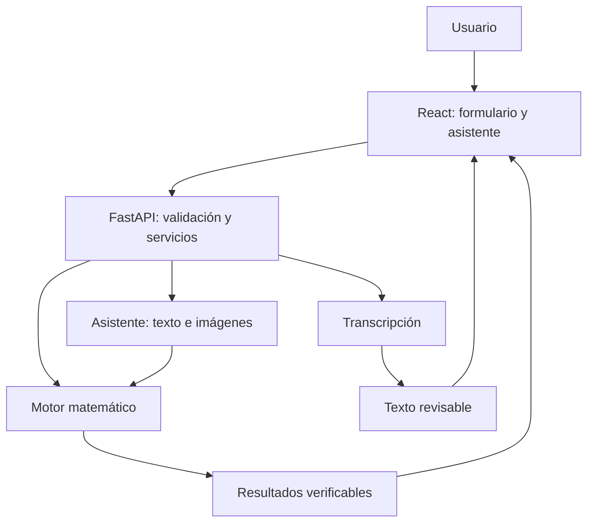

# SIOP

## Sistema Inteligente de Optimización de Pedidos con Rompimiento de Precios

Plataforma web de apoyo a decisiones de compra mediante el modelo de cantidad económica de pedido con descuentos por cantidad y un asistente por texto, fotografía y voz.

| Ficha del proyecto | Definición |
| --- | --- |
| Equipo de desarrollo | Jelibeth y Ruben |
| Sprint | S01 - Prototipo funcional integrado |
| Fecha objetivo | 14 de octubre de 2026, hora de Lima |
| Duración de planificación | 3 horas y 45 minutos desde el inicio del trabajo |
| Método de organización | Sprint de un día con backlog priorizado, responsables, criterios de aceptación y revisión final |
| Estado | Planificación; los entregables aún no se consideran implementados |

> Este README es el acuerdo de trabajo del sprint. La estructura, los servicios y las funciones descritas son entregables por construir. Los tiempos son estimaciones de planificación; el cumplimiento se comprueba con los criterios de aceptación.

## 1. Objetivo del sprint

Entregar hoy una aplicación navegable que permita ingresar un ejercicio de descuentos por cantidad, calcular la mejor alternativa, comparar costos y utilizar asistencia por texto, fotografía y mensaje de voz.

**Resultado esperado de la demostración:** el usuario proporciona sus datos, revisa la información interpretada, obtiene una recomendación verificable y cambia un parámetro para observar su efecto.

### Usuario objetivo

Persona que compra mercadería para vender y necesita decidir si un descuento por volumen compensa el costo de mantener más inventario. La interfaz utilizará lenguaje cotidiano y mostrará los símbolos matemáticos dentro del procedimiento.

## 2. Compromiso y prioridades

### P0 - Alcance comprometido para hoy

| ID | Requerimiento funcional | Evidencia de cumplimiento |
| --- | --- | --- |
| RF-01 | Ingresar producto, demanda, período, costo de pedido y mantenimiento fijo o porcentual. | Formulario validado y análisis enviado a la API. |
| RF-02 | Agregar y editar cantidades mínimas y precios por nivel de descuento. | Tabla sin rangos superpuestos ni precios inválidos. |
| RF-03 | Calcular candidatos y seleccionar la cantidad factible de menor costo anual. | Resultado coincidente con los casos de referencia. |
| RF-04 | Mostrar cantidad, precio, inversión por pedido, frecuencia, ciclo y desglose anual. | Resumen, tabla y gráfico comparativo de costos. |
| RF-05 | Comparar la cantidad actual de compra y recalcular al cambiar demanda o mantenimiento. | Comparación antes/después con los mismos supuestos. |
| RF-06 | Interpretar texto y responder preguntas sobre el ejercicio. | Conversación real que propone datos o explica un cálculo vigente. |
| RF-07 | Extraer datos de una fotografía y permitir su revisión. | Imagen de prueba que produce campos editables antes de aplicarlos. |
| RF-08 | Grabar un mensaje, transcribirlo y enviarlo al asistente tras revisarlo. | Recorrido real de grabación, transcripción y aplicación de datos. |
| RF-09 | Mostrar el procedimiento y los supuestos de la recomendación. | Sección desplegable con fórmulas, sustitución y resultados. |
| RF-10 | Ejecutar el frontend y backend juntos con instrucciones reproducibles. | Aplicación integrada y guía de arranque comprobada. |

### P1 - Mejoras únicamente después de aceptar P0

- Guardar y recuperar escenarios en el navegador.
- Resumen imprimible o exportación.
- Curvas de costo con discontinuidades y explorador continuo de cantidades.
- Animaciones adicionales y mayor refinamiento visual.
- Docker, despliegue público y automatizaciones de integración.

### Fuera de este sprint

Cuentas de usuario, base de datos central, conversación continua con respuesta hablada, comparación de proveedores, predicción de ventas, restricciones de presupuesto y modelos con faltantes o descuentos incrementales.

### Requisitos de calidad del incremento

- Interfaz en español, con nombres y unidades comprensibles.
- Uso en computadora y pantalla de celular; botones y campos accesibles mediante teclado.
- Una sola fuente oficial de cálculo: el motor matemático del backend.
- Datos extraídos por IA revisables antes de modificar el análisis.
- Estados visibles de carga, error y respuesta incompleta.
- Un fallo de IA no impide usar el formulario y la calculadora.
- Credenciales de IA exclusivamente en el servidor.
- Datos simulados identificados y separados del modo real.

## 3. Equipo y reglas de trabajo

| Persona | Responsabilidad principal | Archivos de su propiedad |
| --- | --- | --- |
| **Jelibeth** | Contrato, motor matemático, API y servicios de IA. | `apps/api/`, `contracts/`, `fixtures/`. |
| **Ruben** | Diseño, formularios, resultados, interfaz del asistente y conexión del cliente. | `apps/web/`, `tests/e2e/`, guion y capturas de la demostración. |
| **Ambos** | Revisar el contrato, integrar, comprobar resultados y aceptar el incremento. | `README.md`, documentación final y lista de incidencias. |

### Acuerdos operativos

1. Cada tarea tiene una persona ejecutora; la otra revisa el resultado necesario para integrar.
2. Las tareas dependientes de cálculo y API permanecen con Jelibeth. Las tareas de interacción permanecen con Ruben.
3. Ruben desarrolla contra ejemplos JSON y respuestas simuladas; no espera a que el asistente real esté terminado.
4. Los cambios de contrato se comunican antes de modificar campos; se actualizan OpenAPI y ejemplos en la misma entrega.
5. Cada entregable se integra en una rama corta, con una revisión breve de la otra persona.
6. Las incidencias registran problema, responsable y condición para resolverlo.
7. No se añade alcance P1 mientras exista un P0 pendiente.

## 4. Tecnologías acordadas

| Capa | Tecnología | Aplicación en el sprint |
| --- | --- | --- |
| Frontend | React, TypeScript y Vite | Aplicación de una pantalla principal con formulario, resultados y asistente. |
| Estilos | Tailwind CSS | Componentes coherentes, jerarquía visual y adaptación a celular. |
| Formularios | React Hook Form y Zod | Validación inmediata y mensajes junto al campo. |
| Gráficos | Recharts | Comparación por alternativa; curvas avanzadas quedan en P1. |
| Backend | Python, FastAPI y Pydantic | Validación, API documentada y coordinación de servicios. |
| Motor matemático | Python puro | Fórmulas reproducibles, sin dependencias de la IA. |
| Texto y fotografía | SDK de OpenAI para Python y Responses API | Interpretación con salida estructurada y explicaciones. |
| Voz | MediaRecorder y API de transcripción | Mensaje grabado; el usuario revisa el texto antes de enviarlo. |
| Contrato | OpenAPI, JSON y tipos TypeScript | Estructuras consistentes para trabajar en paralelo. |
| Pruebas | pytest, Vitest y recorrido con Playwright | Casos matemáticos, validación e integración esencial. |
| Simulación | MSW con ejemplos compartidos | Desarrollo del cliente sin dependencia de servicios reales. |

No se incorpora una base de datos al incremento de hoy. Se fijarán las versiones en los archivos de dependencias. El proveedor y los modelos de IA quedarán configurables mediante variables de entorno.

## 5. Sprint backlog y entregables

### S01-01. Contrato y base de integración

**Prioridad:** P0. **Ejecutora:** Jelibeth. **Revisor:** Ruben. **Dependencias:** ninguna. **Estimación:** 15 minutos por persona en paralelo.

**Historia:** como desarrollador, necesito entradas y salidas acordadas para integrar sin rehacer componentes.

| Jelibeth debe hacer | Ruben debe hacer |
| --- | --- |
| Crear la base FastAPI y definir los esquemas de análisis, respuesta del asistente y error. | Crear la base React/TypeScript/Vite y preparar la estructura de la pantalla. |
| Publicar un ejemplo JSON de análisis completo y uno de error. | Incorporar esos ejemplos al cliente de desarrollo y confirmar que bastan para representar las pantallas. |
| Registrar los casos de referencia y dejar `GET /api/v1/health` operativo. | Preparar `api-client.ts`, la dirección configurable de la API y el modo simulado. |
| Comprobar acceso a la API de IA y documentar las variables requeridas. | Comprobar acceso al micrófono en el navegador previsto para la demostración. |

**Criterios de aceptación**

- [ ] Ambos conocen los mismos nombres de campos y unidades.
- [ ] Ruben puede renderizar el ejemplo sin backend funcional de análisis.
- [ ] La salud del servidor responde y se conoce si hay acceso real al proveedor de IA.
- [ ] El repositorio contiene ejemplos de configuración sin credenciales reales.

**Evidencia:** contrato inicial, ejemplos JSON y ambas aplicaciones iniciando por separado.

### S01-02. Motor de cálculo y API de análisis

**Prioridad:** P0. **Ejecutora:** Jelibeth. **Revisor:** Ruben. **Dependencias:** S01-01. **Estimación:** 60 minutos.

**Historia:** como comerciante, quiero comparar todos los niveles de precio para elegir la compra de menor costo anual.

**Jelibeth debe hacer**

- [ ] Recuperar como referencia las fórmulas y casos de la calculadora existente y comprobar su comportamiento antes de trasladarlos al módulo Python.
- [ ] Normalizar demanda y mantenimiento a una base anual. Para hoy: períodos día, mes y año, con días por año configurables.
- [ ] Implementar mantenimiento fijo y porcentual; aplicar la tasa al precio de cada tramo.
- [ ] Calcular CEP por tramo, candidatos factibles y límites de descuento.
- [ ] Evaluar cantidades enteras vecinas factibles y límites para obtener la recomendación práctica.
- [ ] Devolver costos anuales de compra, pedidos, mantenimiento y total; inversión por pedido, frecuencia y duración del ciclo.
- [ ] Incorporar la cantidad actual del usuario como alternativa comparable.
- [ ] Exponer `POST /api/v1/analyses` y devolver errores de validación por campo.
- [ ] Ejecutar pruebas de referencia y de los puntos exactos de descuento.
- [ ] Entregar a Ruben una solicitud y una respuesta reales al terminar el bloque.

**Ruben debe hacer al recibirlo:** conectar un caso de referencia con `api-client.ts` y reportar diferencias de campos o formato; no reimplementar las fórmulas en el frontend.

**Criterios de aceptación**

- [ ] ILY produce 1000 unidades y costo anual de 150840 con sus datos de referencia.
- [ ] Wohl produce 1000 unidades y costo anual de 24725 con sus datos de referencia.
- [ ] Demanda mensual y anual equivalentes producen el mismo resultado.
- [ ] Se incluyen compra y mantenimiento correcto de cada precio.
- [ ] Cantidad recomendada y costos asociados corresponden a la misma alternativa.
- [ ] La API calcula sin conexión con la IA.

**Evidencia:** módulo de cálculo, endpoint operativo y pruebas ejecutadas.

### S01-03. Interfaz, formulario y resultados

**Prioridad:** P0. **Ejecutor:** Ruben. **Revisora:** Jelibeth. **Dependencias:** S01-01; se desarrolla con respuestas simuladas. **Estimación:** 90 minutos.

**Historia:** como persona que vende productos, quiero ingresar mis datos sin conocer notación matemática y entender la recomendación.

**Ruben debe hacer**

- [ ] Definir una identidad visual profesional: fondo claro, tipografía legible, color principal sobrio y acento para la recomendación.
- [ ] Construir una pantalla con ingreso de datos, resultados y asistente accesible.
- [ ] Usar preguntas como «¿cuántas unidades vendes?» y mostrar siempre el período.
- [ ] Implementar mantenimiento fijo o porcentual, costo de pedido y días por año.
- [ ] Crear una tabla editable de cantidades mínimas y precios, con agregar/eliminar filas.
- [ ] Incorporar validación y mensajes concretos para datos faltantes o inválidos.
- [ ] Mostrar cantidad recomendada, precio, inversión por pedido, frecuencia y costo anual.
- [ ] Mostrar tabla de alternativas y gráfico de barras con su costo anual.
- [ ] Incluir compra actual, comparación y cambio de demanda/mantenimiento con recálculo.
- [ ] Incorporar procedimiento y supuestos dentro de una sección desplegable.
- [ ] Evitar que resultados o explicaciones anteriores se presenten como actuales mientras cambian los datos.
- [ ] Adaptar el recorrido a celular, incluyendo tablas sin cortar datos importantes.

**Jelibeth debe revisar:** unidades y etiquetas del resultado, interpretación de costos, caso actual y correspondencia con el contrato.

**Criterios de aceptación**

- [ ] El recorrido se puede completar con el ejemplo simulado y después con la API real.
- [ ] No se requiere conocer símbolos como C1, C2 y C3 para completar el formulario.
- [ ] El usuario distingue costo de un pedido y costo anual.
- [ ] El cambio de datos actualiza el análisis y su comparación.
- [ ] Se reconoce cuándo los datos son simulados o reales.

**Evidencia:** pantalla funcional, caso precargado y una captura de computadora y otra de celular.

### S01-04. Servicio del asistente por texto y fotografía

**Prioridad:** P0. **Ejecutora:** Jelibeth. **Revisor:** Ruben. **Dependencias:** S01-02. **Estimación:** 60 minutos.

**Historia:** como usuario, quiero explicar mi ejercicio o subir una cotización para recibir ayuda y completar los datos.

**Jelibeth debe hacer**

- [ ] Implementar el adaptador del proveedor y los modelos configurables.
- [ ] Crear `POST /api/v1/assistant/messages` y `POST /api/v1/assistant/extract-image`.
- [ ] Devolver mensaje, datos propuestos, campos faltantes, campos por revisar y acción sugerida mediante una estructura validada.
- [ ] Formular preguntas sobre períodos, precios o costos ambiguos; no completar valores ausentes sin identificarlos como supuestos.
- [ ] Mantener los datos confirmados hasta que el usuario acepte cambios.
- [ ] Permitir proponer un escenario modificado y explicar un análisis recalculado por el motor.
- [ ] Limitar las acciones a las funciones del producto: proponer datos, aclarar, evaluar y explicar.
- [ ] Tratar las fotografías como datos del ejercicio, sin ejecutar instrucciones que puedan aparecer en ellas.
- [ ] Gestionar archivos inválidos, fallos del proveedor y tiempos de espera.

**Ruben debe revisar:** que la respuesta pueda mostrarse y aplicarse en el formulario con el contrato acordado; cualquier cambio de estructura se acuerda antes de integrarse.

**Criterios de aceptación**

- [ ] Un mensaje con demanda mensual propone valor y período correctos.
- [ ] Una fotografía legible produce un borrador editable.
- [ ] La falta de un costo o período genera una pregunta concreta.
- [ ] La explicación del resultado usa el cálculo vigente.
- [ ] Un error del proveedor devuelve un estado recuperable y no impide el ingreso manual.

**Evidencia:** solicitudes reales de texto e imagen y sus respuestas estructuradas.

### S01-05. Interfaz del asistente e integración de datos

**Prioridad:** P0. **Ejecutor:** Ruben. **Revisora:** Jelibeth. **Dependencias internas:** S01-03. **Integración real:** S01-04. **Estimación:** 45 minutos.

**Historia:** como usuario, quiero conversar y revisar lo que entendió el asistente antes de usarlo en mis cálculos.

**Ruben debe hacer**

- [ ] Implementar chat con mensajes y preguntas sugeridas.
- [ ] Incorporar selección y vista previa de una fotografía.
- [ ] Mostrar el borrador como campos revisables, sin reemplazar automáticamente los datos confirmados.
- [ ] Añadir «Aplicar datos» y recalcular después de la revisión del usuario.
- [ ] Mostrar estados de envío, interpretación, falta de información y error.
- [ ] Incorporar «Explícame el resultado» y «Prueba otro escenario».
- [ ] Desarrollar inicialmente con ejemplos y conectar el servicio real al estar disponible.

**Jelibeth debe revisar:** interpretación de los borradores, errores y correspondencia entre el escenario explicado y el calculado.

**Criterios de aceptación**

- [ ] El usuario puede completar el formulario desde una conversación o una fotografía.
- [ ] Puede corregir un número interpretado antes de calcular.
- [ ] Los datos propuestos tienen una acción clara para aplicarlos o descartarlos.
- [ ] La aplicación conserva el acceso al ingreso manual ante un error de IA.

**Evidencia:** recorrido completo de texto e imagen hacia el análisis.

### S01-06. Servicio de transcripción

**Prioridad:** P0. **Ejecutora:** Jelibeth. **Revisor:** Ruben. **Dependencias:** S01-04. **Estimación:** 20 minutos.

**Jelibeth debe hacer**

- [ ] Implementar `POST /api/v1/assistant/transcribe`.
- [ ] Aceptar el formato de grabación acordado y comprobar tamaño y tipo de archivo.
- [ ] Devolver la transcripción como texto editable.
- [ ] Devolver errores controlados por archivo vacío, formato inválido o fallo del proveedor.
- [ ] Procesar el audio sin almacenamiento permanente en el servidor de la aplicación.

**Ruben debe hacer al recibirlo:** probar un audio generado desde el navegador seleccionado y verificar que puede enviar el texto al endpoint de mensajes.

**Criterio de aceptación:** una grabación se transcribe y puede continuar por el flujo de texto sin implementar una segunda lógica de interpretación.

**Evidencia:** archivo de prueba válido y respuesta real de transcripción.

### S01-07. Grabación y revisión de voz

**Prioridad:** P0. **Ejecutor:** Ruben. **Revisora:** Jelibeth. **Dependencias internas:** S01-05. **Integración real:** S01-06. **Estimación:** 20 minutos.

**Ruben debe hacer**

- [ ] Incorporar iniciar y detener grabación con MediaRecorder.
- [ ] Gestionar el permiso del micrófono y mostrar el estado de grabación.
- [ ] Enviar el audio al servicio de transcripción.
- [ ] Mostrar el texto editable y un botón para enviarlo al asistente.
- [ ] Gestionar falta de permiso, ausencia de audio o error de transcripción.
- [ ] Detener el acceso al micrófono al finalizar o cancelar.

**Jelibeth debe revisar:** formato de audio, manejo del endpoint y mensajes de error.

**Criterio de aceptación:** el usuario puede hablar, corregir la transcripción y obtener datos propuestos para su ejercicio.

**Evidencia:** recorrido real de voz hacia el formulario y el cálculo.

### S01-08. Integración, validación y cierre del sprint

**Prioridad:** P0. **Ejecutores:** ambos, con tareas separadas. **Dependencias:** entregables correspondientes terminados. **Tiempo compartido de validación:** 35 minutos, más 20 minutos de cierre y contingencia.

| Jelibeth debe hacer | Ruben debe hacer |
| --- | --- |
| Corregir diferencias de contrato, validación y cálculo. | Conectar y comprobar todas las rutas del cliente. |
| Ejecutar pruebas matemáticas y de API. | Ejecutar el recorrido manual, texto, imagen y voz; revisar celular. |
| Verificar las respuestas reales y que los secretos no estén en el cliente. | Retirar los mocks del modo real y señalar el modo de demostración. |
| Preparar dependencias y comandos de arranque del backend. | Preparar comandos de arranque/build del frontend y las capturas finales. |
| Contrastar el caso con el cálculo manual y registrar la evidencia de WinQSB disponible. | Preparar el guion de demostración y una grabación de respaldo. |
| Documentar las limitaciones efectivas del servicio. | Actualizar este README con estado real e instrucciones comprobadas. |

**Criterios de aceptación**

- [ ] Un ejercicio puede resolverse de principio a fin con servicios reales.
- [ ] El mismo caso produce el mismo resultado en frontend, API y referencia manual.
- [ ] La comparación con WinQSB solo se marca completada si existe evidencia obtenida en el programa.
- [ ] Texto, fotografía y voz generan datos revisables y no cifras presentadas como seguras sin validación.
- [ ] No quedan errores que bloqueen el flujo principal.
- [ ] El arranque puede repetirse siguiendo las instrucciones.
- [ ] Las funciones incompletas se registran y no se presentan como terminadas.

**Evidencia:** incremento funcional, pruebas, tabla de validación, capturas y guion.

## 6. Cronograma de ejecución de hoy

Los bloques se cuentan desde **T0**, la hora real de inicio. El objetivo es cerrar antes de terminar el 14 de octubre, hora de Lima. Este plan necesita 3 h 45 min: debe empezar a más tardar a las 20:15 para conservar ese margen dentro del día.

| Bloque | Jelibeth | Ruben | Punto de control |
| --- | --- | --- | --- |
| T0 a +15 min | S01-01: contrato, API base y acceso a IA. | S01-01: cliente base y ejemplos. | Contrato acordado y configuración disponible. |
| +15 a +75 min | S01-02: motor y API. | Primeros 60 min de S01-03. | Primera integración mínima de un análisis real; revisión breve de bloqueos. |
| +75 a +105 min | Primera parte de S01-04. | Finalizar S01-03 y conectar resultados reales. | Calculadora utilizable y presentación de resultados. |
| +105 a +135 min | Finalizar S01-04. | Primeros 30 min de S01-05. | Texto y fotografía disponibles en API. |
| +135 a +155 min | S01-06: transcripción. | Finalizar S01-05 e iniciar S01-07. | Flujo de texto/foto conectado y prueba del audio. |
| +155 a +170 min | Revisar integración del asistente y corregir incidencias. | Finalizar S01-07. | Voz conectada; revisión breve del alcance pendiente. |
| +170 a +205 min | S01-08: validación backend y resultados. | S01-08: recorrido completo e interfaz. | P0 aceptado o incidencias identificadas por responsable. |
| +205 a +225 min | Correcciones de cierre y configuración. | Correcciones de cierre, capturas y documentación. | Revisión final y estado real del incremento. |

**Condiciones del plan:** ambos pueden trabajar en paralelo, el entorno de desarrollo está disponible y existe acceso al servicio de IA. La implementación podrá reutilizar el diseño, reglas y casos ya trabajados en la calculadora existente. Si esas condiciones fallan o se inicia más tarde, se actualiza el compromiso; no se ocultan funcionalidades incompletas.

## 7. Tablero y definición de terminado

### Estados del tablero

`Por hacer → En curso → En revisión → Terminado`

Usar la etiqueta `Bloqueado` cuando exista un impedimento, indicando motivo, responsable y siguiente acción. Cada desarrollador mantiene una sola tarea principal en curso.

| ID | Entregable | Responsable | Prioridad | Estado inicial |
| --- | --- | --- | --- | --- |
| S01-01 | Contrato y base de integración | Jelibeth; Ruben configura cliente | P0 | Por hacer |
| S01-02 | Cálculo y API | Jelibeth | P0 | Por hacer |
| S01-03 | Interfaz, formulario y resultados | Ruben | P0 | Por hacer |
| S01-04 | Asistente texto/fotografía | Jelibeth | P0 | Por hacer |
| S01-05 | Interfaz del asistente | Ruben | P0 | Por hacer |
| S01-06 | Transcripción | Jelibeth | P0 | Por hacer |
| S01-07 | Grabación y revisión de voz | Ruben | P0 | Por hacer |
| S01-08 | Integración y cierre | Ambos, según tareas asignadas | P0 | Por hacer |

### Definition of Done

Un entregable solo pasa a **Terminado** cuando:

1. Cumple sus criterios de aceptación.
2. Tiene evidencia comprobable y fue revisado por la otra persona.
3. Sus cambios están integrados y no rompen el recorrido disponible.
4. Incluye errores y estados necesarios para utilizarlo.
5. Actualiza contrato o documentación si los modifica.
6. No contiene credenciales ni presenta mocks como servicios reales.

### Revisión del sprint

Demostrar en este orden: caso manual, explicación de la mejor alternativa, cambio de mantenimiento, fotografía, mensaje de voz y procedimiento. Registrar qué se aceptó, qué quedó pendiente y qué se mejoraría en el siguiente sprint.

## 8. Arquitectura de funcionamiento



La interpretación del asistente genera propuestas. El usuario las revisa y el motor calcula con los datos aplicados. Las explicaciones se basan en el escenario vigente. La clave de IA permanece en el backend.

## 9. Estructura de archivos propuesta

```text
siop/
├── README.md
├── .gitignore
├── docs/
│   ├── alcance.md
│   ├── arquitectura.md
│   ├── reglas-del-modelo.md
│   ├── validacion-winqsb.md
│   └── guion-demostracion.md
├── contracts/
│   ├── openapi.json
│   └── examples/
│       ├── analysis-request.json
│       ├── analysis-response.json
│       ├── assistant-response.json
│       └── validation-error.json
├── fixtures/
│   ├── cases/
│   │   ├── caso-ily.json
│   │   ├── caso-wohl.json
│   │   └── caso-sensibilidad.json
│   └── expected-results/
├── apps/
│   ├── web/
│   │   ├── package.json
│   │   ├── .env.example
│   │   ├── vite.config.ts
│   │   ├── public/
│   │   ├── src/
│   │   │   ├── app/
│   │   │   ├── components/
│   │   │   │   └── ui/
│   │   │   ├── features/
│   │   │   │   ├── onboarding/
│   │   │   │   ├── inventory-form/
│   │   │   │   ├── results/
│   │   │   │   ├── scenarios/
│   │   │   │   ├── assistant/
│   │   │   │   └── report/
│   │   │   ├── services/
│   │   │   │   ├── api-client.ts
│   │   │   │   └── generated/
│   │   │   ├── mocks/
│   │   │   ├── storage/
│   │   │   ├── styles/
│   │   │   └── main.tsx
│   │   └── tests/
│   └── api/
│       ├── pyproject.toml
│       ├── .env.example
│       ├── app/
│       │   ├── main.py
│       │   ├── core/
│       │   │   └── config.py
│       │   ├── routes/
│       │   │   ├── health.py
│       │   │   ├── analyses.py
│       │   │   └── assistant.py
│       │   ├── schemas/
│       │   │   ├── inventory.py
│       │   │   ├── analysis.py
│       │   │   └── assistant.py
│       │   ├── domain/
│       │   │   ├── normalization.py
│       │   │   ├── quantity_discounts.py
│       │   │   ├── candidate_selection.py
│       │   │   └── cost_breakdown.py
│       │   ├── services/
│       │   │   ├── analysis_service.py
│       │   │   └── assistant_service.py
│       │   └── ai/
│       │       ├── provider.py
│       │       ├── tools.py
│       │       ├── transcription.py
│       │       └── prompts/
│       └── tests/
│           ├── unit/
│           ├── integration/
│           └── assistant/
├── tests/
│   └── e2e/
└── deployment/
    └── Dockerfile
```


Las carpetas `scenarios/`, `storage/`, `report/` y `deployment/` corresponden a P1 y se crean solo si se implementa esa mejora. Para hoy se priorizan `inventory-form/`, `results/`, `assistant/`, `domain/`, `routes/`, `schemas/` y los ejemplos del contrato.

Los tipos TypeScript del cliente se obtendrán del contrato OpenAPI y permanecerán versionados. El módulo matemático no importará FastAPI ni el proveedor de IA.

## 10. Contrato mínimo de API

| Método | Ruta | Entrada principal | Salida principal | Responsable |
| --- | --- | --- | --- | --- |
| GET | `/api/v1/health` | Ninguna. | Estado del servidor. | Jelibeth |
| POST | `/api/v1/analyses` | Datos y tabla de descuentos; cantidad actual opcional. | Candidatos, recomendación, desglose, tiempos y comparación. | Jelibeth |
| POST | `/api/v1/assistant/messages` | Mensaje y borrador/escenario vigente. | Respuesta, datos propuestos, preguntas y acción sugerida. | Jelibeth |
| POST | `/api/v1/assistant/extract-image` | Imagen y contexto opcional. | Borrador, campos por revisar y preguntas. | Jelibeth |
| POST | `/api/v1/assistant/transcribe` | Grabación de audio. | Texto editable. | Jelibeth |

Ruben integra todas las rutas mediante `api-client.ts`. El frontend valida para guiar al usuario; el backend vuelve a validar para calcular. Una respuesta inválida del asistente se trata como información pendiente de revisión.

### Entrada de análisis acordada

- Producto y moneda de presentación.
- Demanda, período y días por año.
- Costo por pedido.
- Modo de mantenimiento: fijo o porcentaje; valor y período.
- Tabla de descuentos: cantidad mínima y precio unitario.
- Cantidad actual, si se desea comparar.

### Reglas del modelo

- Descuento aplicado a todas las unidades del pedido.
- Primer rango desde cero y siguientes cantidades mínimas estrictamente crecientes; cada rango termina antes del siguiente.
- Precios positivos y no crecientes; sin huecos ni superposiciones.
- Demanda, costo de pedido y mantenimiento positivos.
- Meses equivalentes a doce por año; conversión diaria según los días indicados.
- Todos los costos se comparan sobre la misma base anual.
- La compra se incluye al comparar precios distintos.
- Cantidades enteras factibles y límites se evalúan; redondear la CEP sin comparar puede cambiar la alternativa correcta.
- Los costos presentados corresponden a la cantidad recomendada y se redondean solo al mostrar.
- La moneda es una etiqueta de presentación; no se realizan conversiones de divisas.

## 11. Casos de aceptación

| Caso | Datos de referencia | Resultado esperado |
| --- | --- | --- |
| ILY | D=10000/año; pedido=9; mantenimiento=10% anual; precios 20, 18 y 15 desde 0, 250 y 1000 unidades. | Q=1000; costo anual=150840. |
| Wohl | D=5000/año; pedido=49; mantenimiento=20% anual; precios 5, 4.80 y 4.75 desde 0, 1000 y 2000. | Q=1000; costo anual=24725. |
| Sensibilidad A | D=2400/año; pedido=40; mantenimiento fijo=5 por unidad/año; precios 20, 19.60 y 19.20 desde 0, 200 y 500. | Q=500; costo anual=47522. |
| Sensibilidad B | Mismos datos de A; mantenimiento fijo=10 por unidad/año. | Q=200; costo anual=48520. |

ILY y Wohl son referencias de los materiales estudiados. Los escenarios de sensibilidad son ejemplos simulados para demostrar que un aumento del mantenimiento puede cambiar la recomendación.

La evidencia de WinQSB se registra en `docs/validacion-winqsb.md` con datos, configuración y capturas. Se comprueba que el tratamiento del mantenimiento coincida antes de exigir igualdad de resultados. Obtener una salida de la API no equivale a haber ejecutado WinQSB.

## 12. Riesgos y decisiones para conservar el cierre de hoy

| Situación | Acción | Responsable |
| --- | --- | --- |
| Falta acceso o crédito al proveedor de IA. | Detectarlo en S01-01; resolver la configuración o registrar el bloqueo. La calculadora sigue avanzando. | Jelibeth |
| Backend y frontend usan campos diferentes. | Conservar el contrato y corregir el adaptador; no cambiar ambos lados sin acuerdo. | Ambos |
| El navegador no permite grabar. | Comprobar localhost o HTTPS y permisos; permitir subir un archivo de audio como alternativa visible. | Ruben |
| La fotografía es ambigua. | Pedir revisión o ingreso manual de los campos afectados. | Jelibeth y Ruben, cada uno en su capa |
| El tiempo se consume en diseño o nuevas funciones. | Mantener el alcance P0; postergar P1 y limitar el retoque a problemas de legibilidad y uso. | Ambos |
| Existe un bloqueo P0 al llegar al cierre. | Documentarlo, demostrar solo lo operativo y acordar expresamente el alcance entregado. | Ambos |

Los mocks sirven para desarrollar y probar, no para afirmar que una función real está terminada. El cierre de hoy se evalúa por funcionamiento comprobado y alcance declarado.

## 13. Preparación para ejecutar el proyecto

### Frontend — Rubén

Base React/TypeScript/Vite en `apps/web/`. Entorno utilizado: **Node.js 22.11.0** y **npm 10.9.0**. Las versiones de dependencias están fijadas en `package.json` y `package-lock.json`.

Desde la raíz del repositorio, en PowerShell:

```powershell
cd apps/web
npm install --cache .npm-cache --no-audit --no-fund
if (-not (Test-Path -LiteralPath .env)) {
    Copy-Item -LiteralPath .env.example -Destination .env
}
npm run dev
```

La copia inicial conserva un `.env` que ya exista. Su configuración de ejemplo es:

```dotenv
VITE_API_BASE_URL=http://localhost:8000/api/v1
VITE_USE_MOCKS=true
```

Abrir la dirección que Vite muestra en la terminal, normalmente **http://localhost:5173/**. Mantener esa terminal abierta; `npm run build` genera archivos para producción y no inicia un servidor. Si el puerto está ocupado, Vite puede ofrecer otro. Para detenerlo, usar `Ctrl+C`.

En otra terminal de PowerShell, desde la raíz del repositorio:

```powershell
cd apps/web
npm run build
npm test
```

`npm run build` ejecuta `tsc -b` y luego Vite; la salida de producción queda en `apps/web/dist/`. Las pruebas verifican los casos de referencia, formularios, resultados, borradores y liberación del micrófono mediante dobles de navegador y servicios.

Verificación de esta entrega: instalación y configuración comprobadas, servidor de desarrollo operativo, build generado sin errores ni avisos de TypeScript y **106 pruebas aprobadas** en **7 archivos**. Vite/Rollup muestra dos avisos sobre anotaciones de comentarios de la dependencia Zod; no son avisos de TypeScript ni impiden generar el bundle.

El modo inicial se configura con `VITE_USE_MOCKS`; el encabezado permite alternar entre **Modo Simulado (Mocks)** y **API Real (FastAPI)**. Para iniciar directamente contra el backend, cambiar `VITE_USE_MOCKS=false` y reiniciar Vite. La API debe estar disponible en la dirección configurada y permitir el origen del frontend. Las claves de IA permanecen en el servidor.

En modo simulado se utilizan los cuatro casos precalculados y respuestas de ejemplo del asistente. Otros escenarios requieren la API real. La captura de voz requiere un navegador con MediaRecorder, localhost/HTTPS y permiso del micrófono; siempre existen carga de audio y simulación de prueba como alternativas. Se libera el micrófono al detener, cancelar, cambiar de pestaña o cerrar el asistente. La simulación prepara texto identificado como ejemplo y no representa una transcripción real.

El guion de Rubén está en [docs/guion-demostracion.md](docs/guion-demostracion.md). El frontend no declara como comprobados el micrófono físico, los servicios reales de IA, la integración completa con FastAPI ni WinQSB: esas evidencias y la aceptación conjunta siguen pendientes.

### Backend e integración — Jelibeth y ambos

- Jelibeth documenta entorno Python, instalación, variables, arranque y pruebas del backend.
- Ambos comprueban una ejecución completa con los servicios reales desde sus instrucciones.
- Las claves reales se guardan fuera del control de versiones; los ejemplos de entorno no incluyen secretos.

## 14. Referencias técnicas

- [React con TypeScript](https://react.dev/learn/typescript).
- [Guía de Vite](https://vite.dev/guide/).
- [Tailwind CSS con Vite](https://tailwindcss.com/docs/installation/using-vite).
- [Recharts](https://recharts.github.io/en-US/guide/).
- [FastAPI: funcionalidades, Pydantic y OpenAPI](https://fastapi.tiangolo.com/features/).
- [OpenAI Responses API](https://developers.openai.com/api/reference/responses/overview).
- [OpenAI: salidas estructuradas](https://developers.openai.com/api/docs/guides/structured-outputs).
- [OpenAI: transcripción de archivos de audio](https://developers.openai.com/api/docs/guides/speech-to-text).
- [MediaRecorder](https://developer.mozilla.org/en-US/docs/Web/API/MediaRecorder).
- [Mock Service Worker](https://mswjs.io/docs/).
