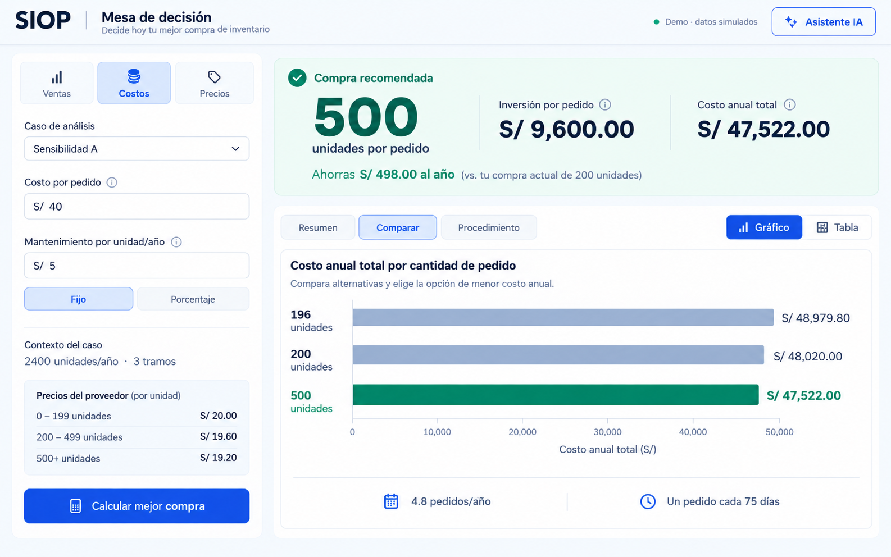
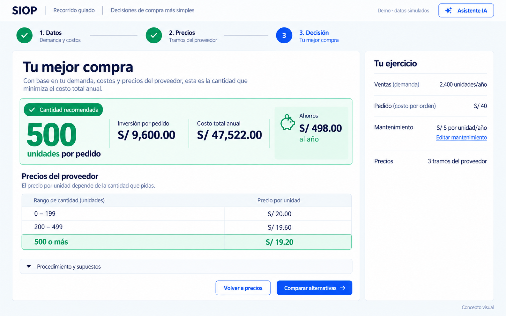
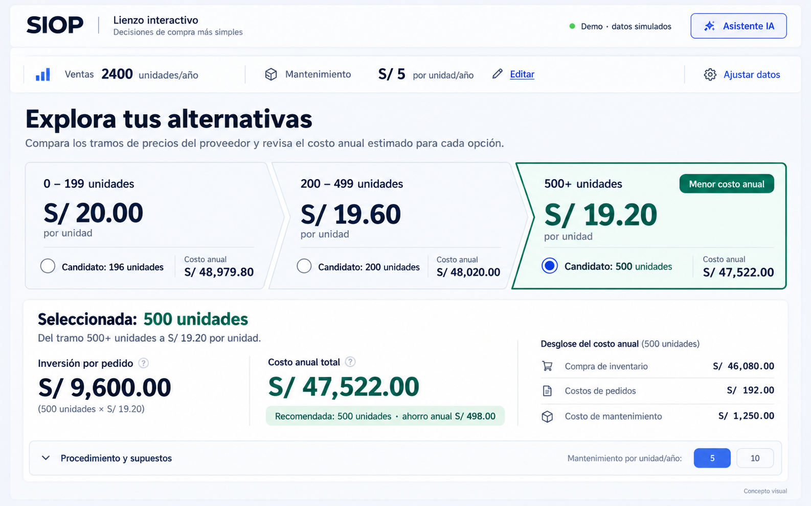

# Conceptos visuales de SIOP

Tres imágenes conceptuales de alta fidelidad para comparar el rediseño antes de implementarlo. Generadas con la herramienta integrada image_gen; no son capturas de la aplicación ni documentos editables de Figma. El frontend de producción no cambia con esta entrega.

## Mesa de decisión

Archivo: mesa-de-decision.png.

Inspector lateral compacto para editar por grupos, recomendación estable y comparación por gráfico o tabla. La revisión elimina las dos tablas de resultados que la primera generación agregó debajo del gráfico, para evitar repetir el problema de saturación.

## Recorrido guiado

Archivo: recorrido-guiado.png.

Tres etapas reversibles: Datos, Precios y Decisión. La imagen representa la última etapa, con resumen del ejercicio y acceso directo a editar mantenimiento. La revisión retira tablas y operaciones secundarias para centrar la pantalla en la decisión.

## Lienzo interactivo

Archivo: lienzo-interactivo.png.

Los tramos de precio son alternativas seleccionables. El detalle de una cantidad se presenta en un área contextual inferior. En la aplicación real se diferenciarán la alternativa seleccionada y la recomendada, y toda evaluación seguirá proviniendo de la API.

## Datos compartidos

Las tres opciones representan Sensibilidad A: demanda 2400 unidades/año, costo de pedido S/ 40, mantenimiento fijo de S/ 5 por unidad/año y precios por tramo 20.00, 19.60 y 19.20. Recomendación: 500 unidades, inversión por pedido S/ 9600.00 y costo anual S/ 47522.00. Comparación con pedido actual de 200 unidades: ahorro anual S/ 498.00.

## Especificación de los prompts

Tipo: ui-mockup. Una imagen por concepto, vista frontal de escritorio en formato horizontal, acabado de diseño de producto similar a una presentación de Figma, textos en español y los mismos datos financieros en todas las propuestas. Sin computadoras fotografiadas, perspectiva, personas, objetos 3D ni funciones inventadas.

Sistema visual solicitado: fondo frío claro #F7F9FC, superficies blancas, texto azul oscuro #172B40, acciones azules #2455DB, recomendación esmeralda #087B62, Inter o equivalente y numerales tabulares. Jerarquía clara, espaciado moderado, contraste legible y modo Demo identificado.

Prompt de Mesa: inspector del 30 % con Ventas/Costos/Precios, Costos activo, campos de pedido y mantenimiento, resumen del ejercicio y acción Calcular mejor compra. Área del 70 % con 500 unidades, inversión y costo anual diferenciados, ahorro y Comparar activo. Un único gráfico de tres candidatos con base cero y valores directos. La revisión pide conservar todo lo anterior y eliminar tablas de resultados, cálculos visibles y contenedores extra.

Prompt de Guiado: navegación de tres pasos con Decisión activo, sin inspector de edición permanente. Resultado principal a la izquierda y resumen del ejercicio a la derecha. Una sola tabla compacta de precios del proveedor, enlace Editar mantenimiento, procedimiento plegado y acciones Volver a precios/Comparar alternativas. La revisión pide eliminar el desglose y la tabla de otras alternativas, así como todas las operaciones aritméticas visibles.

Prompt de Lienzo: controles compactos de demanda y mantenimiento; tres tramos de proveedor conectados como secuencia visual, candidatos 196, 200 y 500; tercero seleccionado y recomendado. Una sola zona contextual inferior muestra inversión por pedido, costo anual y desglose de la alternativa seleccionada. Se solicita no representar los tramos como una curva continua ni inventar un motor de cálculo.

## Evaluación

Comparar facilidad de configuración, jerarquía, atractivo, claridad entre inversión y costo anual, y utilidad de las interacciones sugeridas. Las imágenes permiten valorar la dirección visual; los detalles de accesibilidad, responsividad y comportamiento deben validarse en componentes reales. La matriz completa está en el plan de rediseño de la carpeta superior.
