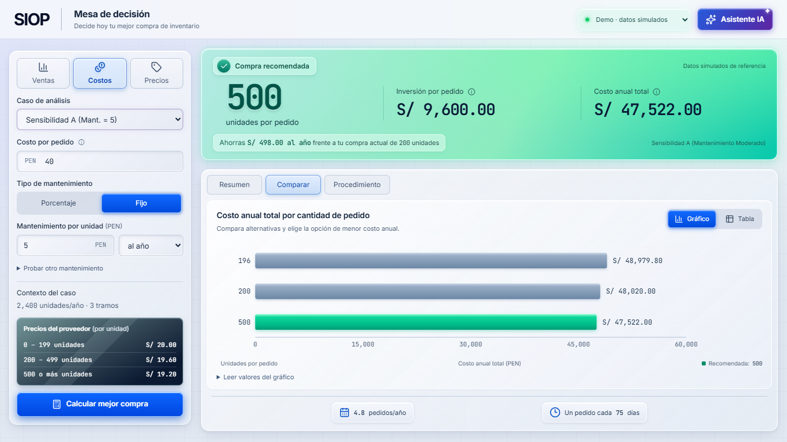
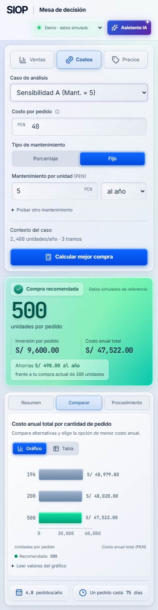
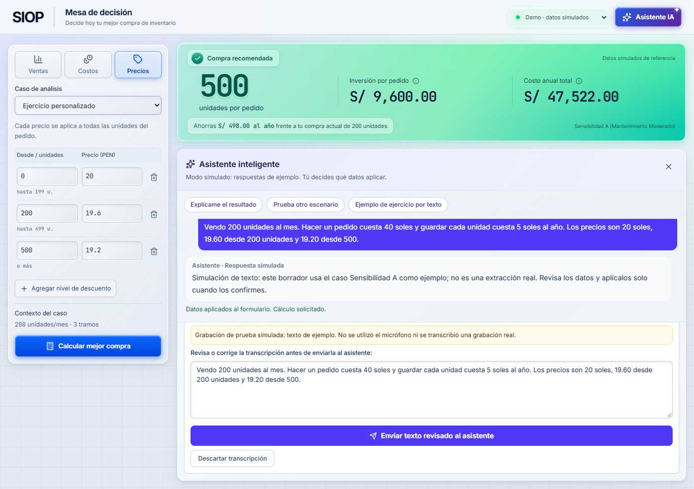
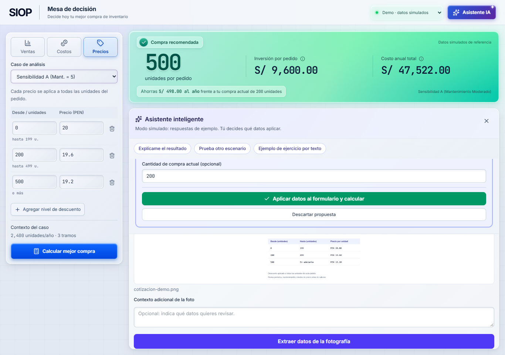

# Mesa de decisión: implementación

Fecha de revisión: 15 de octubre de 2026, hora de Lima.

## Dirección aceptada

Se conserva la estructura de Mesa de decisión seleccionada por el usuario y se aplica el acabado de su referencia: vidrio claro, profundidad suave, controles azules luminosos, recomendación con degradado esmeralda y acción de IA violeta. Las luces y texturas se producen con CSS; las imágenes conceptuales no se usan como fondo de la aplicación.

Tokens principales: fondo #E3E9F2, texto #13243C, acción #0754ED, recomendación #00B987, acento IA #4636B5 y superficies blancas translúcidas. Inter para interfaz y JetBrains Mono con cifras tabulares para cantidades, importes y fórmulas. Texto alineado a la izquierda y valores comparables alineados en tablas.

```text
SIOP | Mesa de decisión                    Demo | Asistente IA
┌───────────────────┬─────────────────────────────────────────┐
│ Ventas Costos     │ Compra recomendada | inversión | anual   │
│ Precios           ├─────────────────────────────────────────┤
│ Caso y campos     │ Resumen | Comparar | Procedimiento       │
│ del grupo activo  │                                         │
│ Contexto          │ Una vista de resultados a la vez         │
│ Precios resumidos │ o el asistente al abrirlo                │
│ Calcular          │ Frecuencia y ciclo de compra             │
└───────────────────┴─────────────────────────────────────────┘
```

La identidad visual se concentra en el resultado y los controles. No se añaden secciones de producto, indicadores decorativos ni curvas matemáticas nuevas.

## Cambios funcionales de presentación

- Formulario dividido en Ventas, Costos y Precios. Los valores permanecen al cambiar de pestaña; no hay un segundo editor de demanda o mantenimiento en los resultados.
- Selector compacto con los cuatro casos de referencia. Se conserva ILY como caso inicial; las capturas muestran Sensibilidad A para comparar directamente con la referencia visual elegida.
- Resultados separados en Resumen, Comparar y Procedimiento. Gráfico y tabla se alternan; la preferencia se mantiene al volver de otra vista.
- La tabla ofrece cantidad, precio y costo anual, con el desglose de cada tramo bajo demanda. Conserva su desplazamiento interno en móvil.
- La compra actual aparece en el gráfico solamente si no coincide ya con un candidato calculado. La comparación Antes/Después sigue accesible en Resumen.
- Los errores abren el grupo correspondiente y enfocan el primer campo inválido. Las pestañas admiten flechas, Inicio y Fin.
- El asistente usa el espacio de trabajo de los resultados al abrirse. El formulario permanece disponible y se evita añadir una tercera columna estrecha.

## Movimiento y estados

Entrada breve de la mesa, transiciones de panel de 180 ms, respuesta de botones al pasar, enfocar y presionar, y transición de barras con los valores devueltos. No se calculan cantidades EOQ ni se inventan valores intermedios en el cliente. No hay movimiento decorativo continuo; se respeta prefers-reduced-motion.

Se conservan el aviso ámbar y la atenuación cuando un resultado queda pendiente, la procedencia Demo/Real, los errores recuperables del proveedor de IA, la revisión del borrador antes de aplicar y la liberación del micrófono al detener, cancelar o cerrar.

## Skills y plugins revisados

- frontend-design y siop-frontend-system: skills existentes aplicadas al diseño y a las restricciones del dominio. La referencia del usuario sustituye las instrucciones de acabado visual anteriores.
- find-skills y plugin-management: utilizados para buscar y verificar opciones; no se instalaron paquetes de skills dentro del frontend.
- [web-design-guidelines de Vercel](https://skills.sh/vercel-labs/agent-skills/web-design-guidelines): referencia consultada para formularios, foco, accesibilidad y movimiento. El directorio indicaba 737.5K instalaciones y el [repositorio oficial](https://github.com/vercel-labs/agent-skills) 32.4K estrellas al consultar. Comando disponible para una instalación futura: `npx skills add https://github.com/vercel-labs/agent-skills --skill web-design-guidelines`.
- Figma: se verificó disponible y después instalado durante la sesión. No se creó ni publicó un archivo externo de Figma como parte de esta implementación.

## Evidencia









La revisión automatizada en Chrome se registra en evidencia/redesign-checks.json: 51 comprobaciones, casos ILY/Wohl/Sensibilidad A/B, vistas de 1366, 1024, 850, 390 y 320 px, gráfico y tabla, detalle expandible, resumen, procedimiento, grupos del formulario, validación con foco, fotografía demo, voz simulada, borde ámbar de campos por revisar y reducción de movimiento. No hubo errores JavaScript de página. A 1366 × 768 las vistas iniciales de Comparar y Resumen del caso típico caben en la altura de la ventana.

Vitest: 107 pruebas aprobadas en siete archivos, incluida una prueba nueva de conservación de valores, navegación por teclado y foco sobre el error de una pestaña oculta.

Las pruebas de voz de navegador usan la contingencia de demostración. El permiso de hardware real y los servicios de IA reales dependen del dispositivo y backend; las pruebas de ciclo de vida de MediaRecorder y de error del cliente se mantienen en la suite de Vitest.

## Repetir comprobaciones

Desde apps/web:

```powershell
npm run test
npm run build
npm run dev
```

La revisión visual se ejecuta con Playwright disponible y Chrome instalado:

```powershell
$env:SIOP_REVIEW_URL = 'http://localhost:5173/' # Usa el puerto mostrado por Vite
node tests/browser-redesign.cjs
```

Si Playwright está en un runtime existente en vez de node_modules, definir SIOP_PLAYWRIGHT_PATH con la ruta a ese paquete. El script guarda las capturas y el informe dentro de apps/web/design/evidencia. No instala dependencias automáticamente.

El build puede mostrar dos avisos de anotaciones PURE provenientes de Zod/Rollup que ya existían antes del rediseño; son avisos de empaquetado de la dependencia, distintos de errores o warnings de TypeScript.
